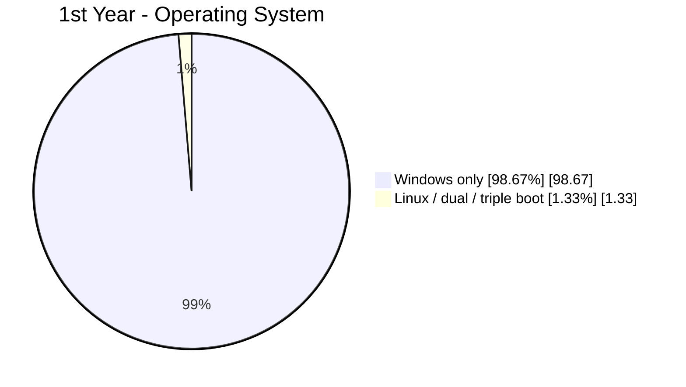
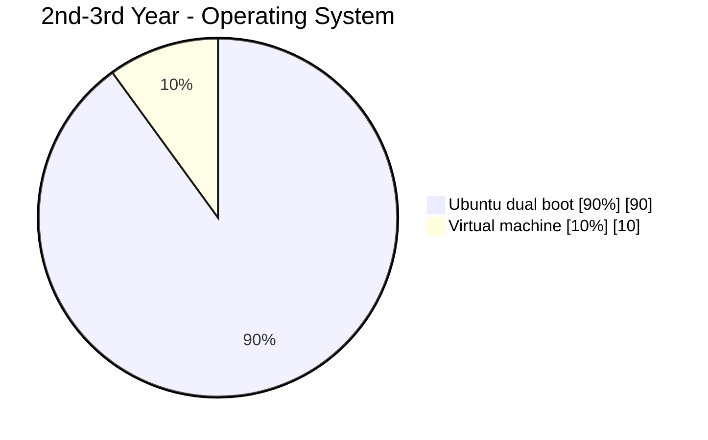
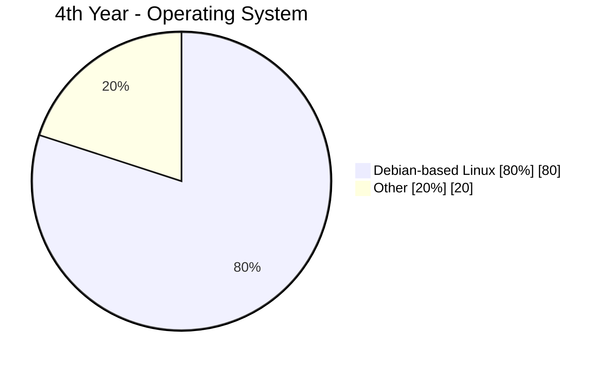
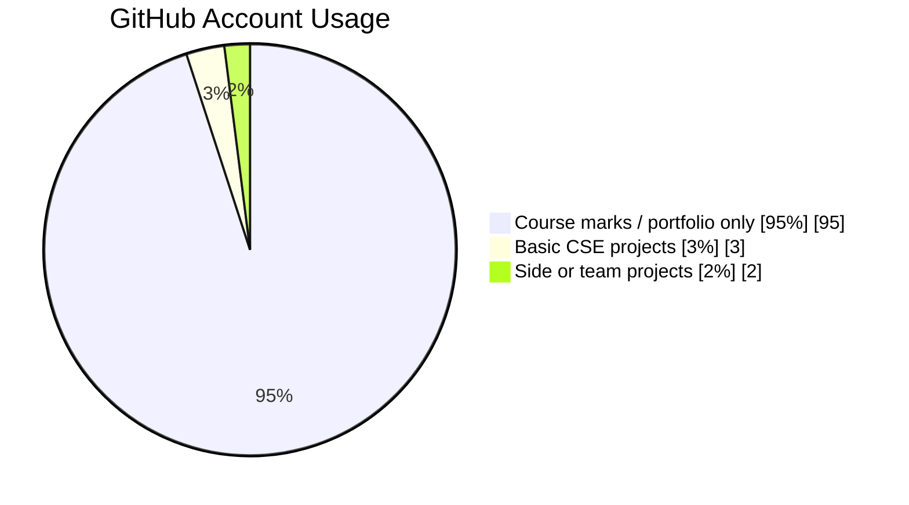
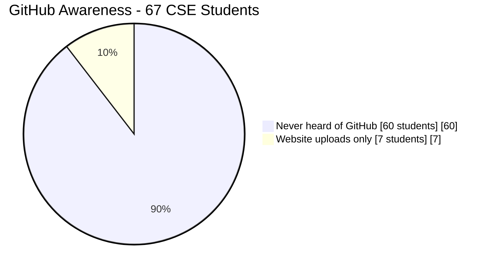
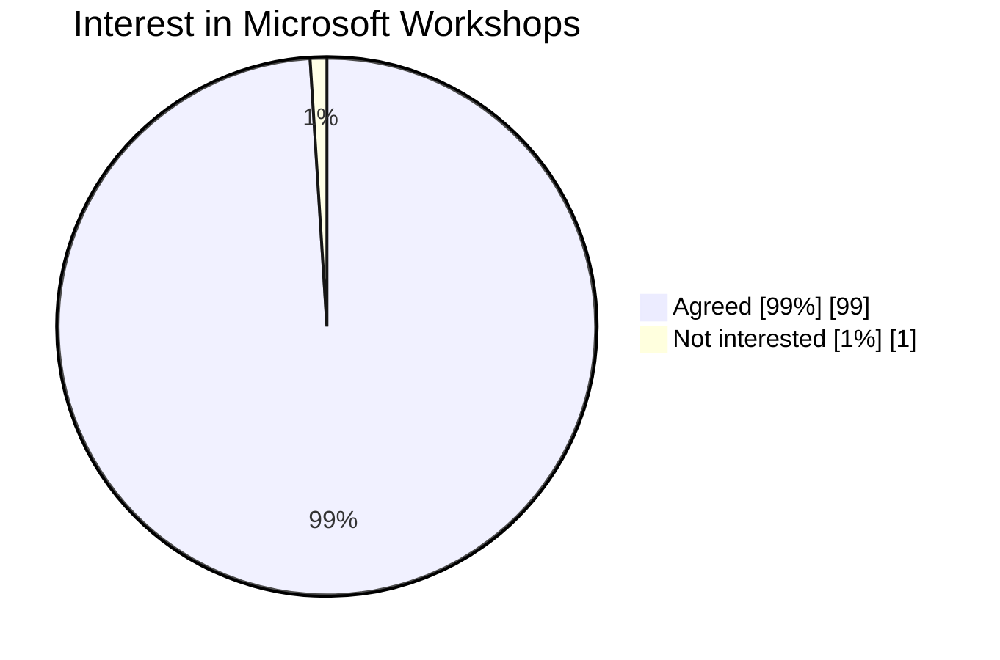
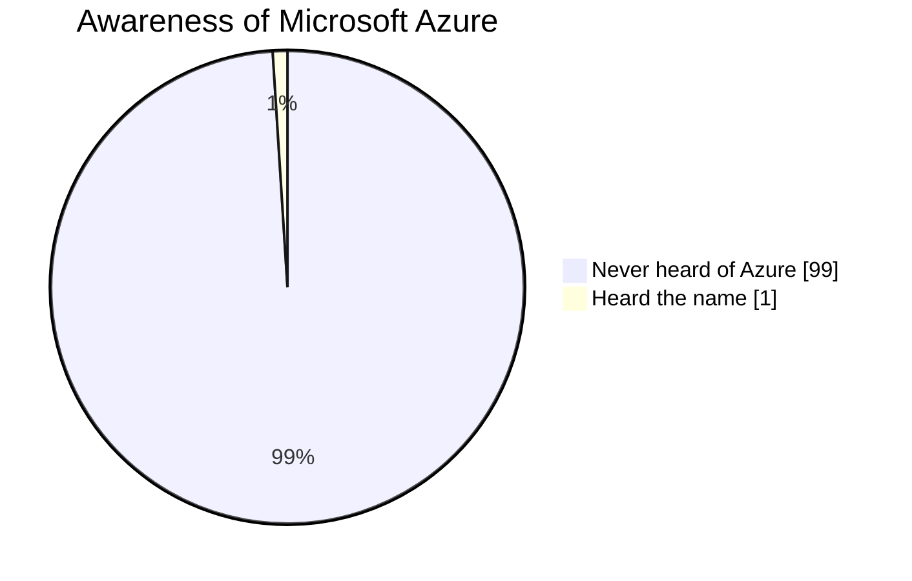

# Developer Tools and the Microsoft Ecosystem at EWU

*A Community Survey of CSE and Data Science Students at East West University (EWU)*

**Survey Date:** 5 November 2026  
**Conducted by:** Sameer Al Sahab  
**Institution:** East West University

---

## 1. Background

Students at EWU learn programming, but many have limited experience with the tools and workflows used in collaborative software development.

From our survey, we found that most students with GitHub accounts use them mainly for course submissions or portfolios. Very few use Git for collaboration, and awareness of Microsoft Azure is limited.

Despite this, almost all surveyed students expressed interest in attending workshops on Microsoft technologies.

This suggests that the main gap is exposure rather than interest. The findings will help identify areas where practical sessions on Git, GitHub, VS Code and Microsoft Azure could benefit students, particularly when working on group assignments and capstone projects.

---

## 2. Survey Overview

| Category | Details |
|---|---|
| Institution | East West University (EWU) |
| Departments | Computer Science and Engineering (CSE) and Data Science |
| Academic levels | 1st to 4th year |
| Survey date | 5 November 2026 |
| Face-to-face responses | 76 |
| Google Form responses | 8 |
| Total recorded responses | 84 |

### Survey Methodology

The survey was conducted through face-to-face conversations and an online Google Form.

Most responses came from direct conversations with students, as the Google Form received limited participation.

This was an informal community pilot survey rather than a formal statistical study. Percentages are presented as reported estimates and should not be treated as representative statistics of the entire EWU student population.

Unless otherwise specified, the figures below reflect the responses collected for the respective questions. Some observations were collected from specific groups of students.

---

## 3. Survey Findings

### 3.1 Operating Systems

Operating system preferences appear to change as students progress through their academic years.

Most first-year students use Windows exclusively. In the second and third years, Ubuntu dual boot becomes more common. By the fourth year, many students use Debian-based Linux distributions, often for project-related requirements.

This suggests that students gradually become more familiar with Linux through their coursework and personal projects.

**First Year**

**Second and Third Year**

**Fourth Year**

### 3.2 Editors and Development Tools

VS Code is the most commonly used editor among surveyed students, with a reported usage rate of 88.7%.

Code::Blocks is also widely used, mainly because it is installed on university lab computers and commonly used in programming courses. However, it was not included in the original survey options.

Online compilers such as OneCompiler and Programiz are also frequently used.

| Tool | Reported Usage |
|---|---:|
| VS Code | [88.7%] |
| Android Studio | [0.2%] |
| Jupyter | [0.1%] |
| Code::Blocks | Almost everyone (not counted) |
| Online compilers | Very common (not counted) |

*Note: The percentages above are reported tool-usage figures, not necessarily mutually exclusive categories.*

### 3.3 Git and GitHub

GitHub accounts are relatively common among students familiar with the platform, but their usage is mostly limited to academic submissions and portfolios.

Common examples include small course projects, ticket counters, medical service simulators and personal GitHub Pages websites.

Collaborative development and personal side projects are much less common. None of the surveyed students reported using GitLab or Bitbucket, and awareness of these platforms was limited.

**Reported reasons for having a GitHub account**

**GitHub Awareness Among Early-Semester CSE Students**

An additional observation was collected from 67 first- and second-semester CSE students through direct conversations.

Among them, 60 had never heard of GitHub. The remaining 7 were familiar with it but mainly used the website to upload files. None reported using Git commands, commits, branches or merges.

| Response | Students | Percentage |
|---|---:|---:|
| Never heard of GitHub | 60 | [89.55%] |
| Familiar with GitHub, website uploads only | 7 | [10.45%] |
| Total | 67 | [100%] |

These findings suggest that simply having a GitHub account does not necessarily mean students understand version control or collaborative development.

### 3.4 Microsoft Tools and Services

Interest in Microsoft-related workshops was particularly high.

Around 99% of respondents expressed interest in attending workshops on Microsoft technologies. However, actual participation will be a better indicator of how strong that interest is.

**Interest in Microsoft Workshops**

**Awareness of Microsoft Azure**

Azure was one of the least familiar technologies among the students surveyed. Almost all respondents had only heard its name, with very little practical knowledge.

**Other Microsoft Products and Services**

| Tool or Service | Observed Usage |
|---|---|
| Word, Excel, PowerPoint | Used by all students |
| Outlook | Used by most students |
| Teams, OneDrive | Used by some students |
| Azure, Power BI, Power Platform | Rarely used |
| Microsoft Copilot app | Tried by some, but generally not preferred |

For AI assistants, students more commonly mentioned ChatGPT, Gemini and Claude.

The Microsoft Copilot app did not receive much positive feedback from the students who had tried it. GitHub Copilot was not discussed during the survey, so no conclusions can be drawn about its usage.

### 3.5 Time and Availability

Most students said they could dedicate around 1 to 3 hours per week to additional learning activities.

However, academic pressure and existing coursework make regular participation difficult for some students.

A few respondents also expressed interest in other technical areas, particularly cybersecurity.

This is worth considering when planning workshop schedules and selecting topics.

---

## 4. Summary of Findings

1. Most first-year students use Windows, while Linux becomes more common in later academic years.
2. VS Code is the most commonly used editor, although Code::Blocks and online compilers remain widely used.
3. GitHub is primarily used for course submissions and portfolios rather than collaboration.
4. Git commands and workflows such as branching, committing and merging are rarely used by the students surveyed.
5. Awareness of GitLab and Bitbucket is limited.
6. Azure awareness is very low, despite strong interest in Microsoft-related workshops.
7. Students who use AI assistants generally prefer ChatGPT, Gemini and Claude over the Microsoft Copilot app.
8. Most students have limited free time, so additional learning sessions should be short and practical.

---

## 5. Conclusion

This survey indicates that students are interested in learning about development tools but do not get much opportunity to work with them outside of basic course work. Increasing knowledge of GitHub, hands on experience with version control and gaining an understanding of cloud services are all areas that students could benefit from some guidance. The results give us an insight into the current situation regarding students at EWU and will help when planning future workshops. Students can attend and get hands on to help determine their interest and what they have learned. The aim is to help students improve from writing code on their own and feel more confident working in teams, project management and using common tools within software development.

---

